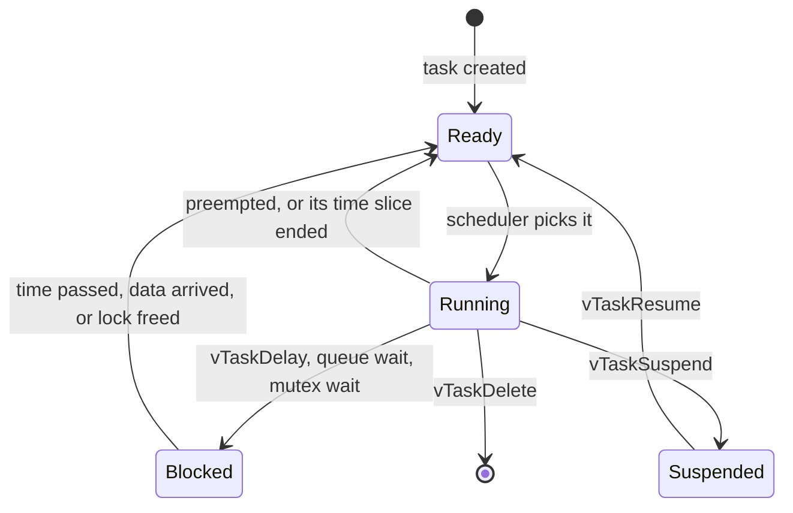

# Task Manager: how ORA-OS creates and keeps track of its tasks

> **Files covered:** `main/core/taskManager.h`, `main/core/taskManager.cpp`, plus the priority and stack constants in `main/config.h` and `cpuCores` in the board profile
> **Level:** beginner-friendly. No prior RTOS knowledge assumed.
> **You will learn:** what a task really is, how the scheduler chooses what runs, what priorities, stacks, cores and watchdogs mean, and why the task manager is written the way it is.
> **Read first:** [events.md](events.md). The event bus is how tasks talk; this document is about the tasks themselves.

---

## 1. The problem we are solving

An operating system is mostly a crowd of tasks: one for the UI, one for audio, one for the SD card, one for Wi-Fi, and so on. The raw FreeRTOS way to create one looks like this:

```cpp
xTaskCreate(audioTask, "audio", 4096, nullptr, 10, nullptr);
```

That single line hides four decisions, written as bare numbers:

| Number | Meaning |
|---|---|
| `"audio"` | the name, which is how you recognise it in a crash log |
| `4096` | how many **bytes** of stack it gets |
| `10` | its **priority** |
| `nullptr` | the parameter passed to it |

If every module makes these decisions privately, you end up with problems:

| Problem | What goes wrong |
|---|---|
| **Scattered magic numbers** | Is 10 more important than 8? Nobody can see all the priorities at once, so the audio task ends up outranked by something silly. |
| **No inventory** | When the system misbehaves, you cannot ask "which tasks exist and how healthy are they?" |
| **Wrong stack sizes** | Too small crashes randomly. Too big wastes precious internal RAM. Without measurement it is guesswork. |
| **No board awareness** | Pinning a task to core 1 on a single-core chip simply fails. |

The task manager fixes this with one rule: **every task is created through `taskManager::spawn()`**, from a small description of what it needs. That gives us one place for priorities and stack sizes, one list of tasks, and one health report.

---

## 2. The idea in one analogy

Picture a **restaurant kitchen**.

- Each **cook** is a task. A cook does one job in a loop: take an order, cook, wait for the next order.
- The kitchen has **two stoves** (the two CPU cores). Only two cooks can actually cook at the same instant.
- Each cook has a **workbench** (the stack). Complicated dishes need a bigger bench. If a cook runs out of bench space, ingredients spill onto the neighbour's bench, which is a stack overflow.
- The **head chef** (the scheduler) decides who gets a stove. Whenever a more important order arrives, such as a customer's emergency, the head chef pulls a cook off the stove and puts the important one on. That is **preemption**.
- Cooks with the same importance take **turns**, a few milliseconds each.
- A cook with nothing to do **sits down** (blocked) and uses no stove at all.
- The **inspector** (the watchdog) checks that someone is sitting idle now and then. If every cook is frantic all the time, the inspector declares the kitchen broken and shuts it down (a reboot).
- The **manager's clipboard** (the task manager) lists every cook, their station, their importance and how much bench space they actually use.

---

## 3. Background concepts

### 3.1 The task states

A task is always in exactly one of these states:



- **Running:** on a core right now.
- **Ready:** could run, but every core is busy with someone more important.
- **Blocked:** waiting for something. It costs **zero CPU**. Most tasks spend most of their life here.
- **Suspended:** deliberately parked until someone resumes it.

### 3.2 The tick and the scheduler

FreeRTOS keeps time in **ticks**. We set `CONFIG_FREERTOS_HZ=1000`, so one tick is 1 millisecond. At every tick the scheduler can reconsider who should run. The rule is simple:

> **Always run the highest-priority task that is ready. Among equals, take turns.**

A higher number means a higher priority. Tasks of equal priority share a core in round-robin fashion, one tick each.

### 3.3 Priority and starvation

Priority decides who runs **first**. It does not make anything faster. A higher-priority task only gets the core earlier.

The danger is **starvation**. If a high-priority task never blocks, nothing below it ever runs again, including the **idle task**.

### 3.4 The idle task and the watchdog

Each core has an **idle task** at priority 0. It runs only when nothing else is ready. It is not a luxury. It:

- frees the memory of deleted tasks
- lets the CPU rest (and later, sleep to save power)
- **feeds the task watchdog**

The **task watchdog** (default timeout about 5 seconds) reboots the chip if an idle task has not run, and the message names the culprit core, for example `IDLE1`. It is how the system tells you "a task never lets anyone else run."

> **Golden rule: every task loop must block somewhere** (a queue wait, `vTaskDelay`, a mutex wait). A loop that never blocks starves the system.

### 3.5 The stack

Each task has its own **stack**, a private block of memory for local variables and function calls.

- On ESP-IDF, stack sizes are given in **bytes** (in vanilla FreeRTOS they are in words).
- Task stacks live in **internal RAM**, which is scarce (about 370 KB free on our board), not in PSRAM.
- **Too small:** the task overflows into whatever sits next to it. ESP-IDF catches this with a "canary" check and prints `A stack overflow in task X has been detected`, then reboots.
- **Too big:** you quietly waste internal RAM that Wi-Fi, BLE and drivers also need.
- Any task that calls `ESP_LOGI` needs roughly 3 KB, because the text formatting happens on the task's own stack.

**The high-water mark** is the key measuring tool. It reports the **smallest amount of free stack the task has ever had**. If a task was given 4096 bytes and the high-water mark says 1800 free, the task has never used more than 2296. Trim to the measured use plus about 25% headroom.

### 3.6 Cores and pinning

The ESP32-S3 has two cores sharing one scheduler. A task can be:

- **pinned** to core 0 or core 1: it only ever runs there
- **unpinned** (`tskNO_AFFINITY`): it runs on whichever core is free

The Wi-Fi and Bluetooth stacks live mostly on core 0. Our plan: put the UI on core 1 so it stays smooth, and put audio and storage services on core 0. Not every ESP32 chip has two cores (the ESP32-C3 has one), so the task manager asks the **board profile** how many cores exist and falls back to "unpinned" when pinning is impossible.

### 3.7 `vTaskDelay` versus `vTaskDelayUntil`

```cpp
vTaskDelay(pdMS_TO_TICKS(1000));        // "sleep 1000 ms from now"
vTaskDelayUntil(&lastWake, pdMS_TO_TICKS(1000));   // "wake at fixed 1000 ms intervals"
```

If your loop does 30 ms of work and then calls `vTaskDelay(1000)`, the real period is 1030 ms, and the error grows every lap. `vTaskDelayUntil` measures from the previous wake-up time, so the period stays exact. Use it for anything periodic. You must set `lastWake = xTaskGetTickCount()` once before the loop.

---

## 4. Design decisions and why we made them

| Decision | The alternative | Why we chose this |
|---|---|---|
| **All tasks created through `spawn()`** | Call `xTaskCreate` wherever needed | One list of tasks, one place that checks arguments, one health report. |
| **Task description is a struct (`taskSpec`)** | Seven positional arguments | Positional numbers are easy to mix up (`4096, 10` or `10, 4096`?). With named fields you can read the call. |
| **Priorities and stack sizes are named constants in `config.h`** | Literal numbers at each call site | You can see the whole priority ladder in one place and change it in one place. |
| **`enum class coreId`** with `core0`, `core1`, `any` | A bare integer | `core: 1` is cryptic. `coreId::core1` says what it means, and `any` replaces the odd-looking `tskNO_AFFINITY`. |
| **Fixed table of handles** (`config::maxManagedTasks`) | A dynamic list | No runtime allocation, so memory use stays predictable. |
| **Stores only the task handle, not the name** | Store a name pointer too | The caller's name string might not live forever. FreeRTOS copies the name into the task itself, and `pcTaskGetName()` reads it back safely. |
| **Explicit `init()`** | Create the mutex lazily on first use | Lazy creation has a hidden race: two tasks could both see "no mutex yet" and both create one. Explicit init at boot is simpler and safe. |
| **`report()` copies the table, releases the lock, then prints** | Print while holding the lock | Printing to the serial port is slow. Holding the lock that long would block every `spawn()`. |
| **Compile-time core check (`if constexpr`)** | A runtime `if` | The board's core count is known when we compile, so the unused branch disappears from the binary. |
| **`spawn()` validates its input** | Trust the caller | A bad priority or tiny stack should fail with a clear message, not a mysterious crash minutes later. |

---

## 5. Walking through the code

### 5.1 `config.h`: the priority ladder and stack sizes

```cpp
constexpr uint8_t maxManagedTasks = 16;

namespace prio {
    constexpr uint8_t background = 2;    // logging, housekeeping
    constexpr uint8_t service    = 5;    // storage, network
    constexpr uint8_t ui         = 8;    // LVGL
    constexpr uint8_t audio      = 10;   // must never underrun
}

namespace stack {
    constexpr uint32_t small  = 3072;
    constexpr uint32_t normal = 4096;
    constexpr uint32_t large  = 8192;
}
```

- **Why audio is the highest:** a music player that stutters is noticed instantly. A UI that is 5 ms late is not. Priority should follow how bad a delay would be.
- **Stay in the 1 to 15 range.** ESP-IDF's own system tasks (the Wi-Fi task, the esp_timer task, the TCP/IP task) run at roughly 18 to 23. Keep ours below them so the system tasks are never starved.
- Gaps between the numbers (2, 5, 8, 10) leave room to insert new levels later without renumbering.

### 5.2 `taskManager.h`: the vocabulary

```cpp
enum class coreId : int {
    core0 = 0,
    core1 = 1,
    any   = tskNO_AFFINITY
};
```

The underlying type must be `int`, because `tskNO_AFFINITY` is a very large number (`0x7FFFFFFF`) that does not fit in a byte.

```cpp
struct taskSpec {
    const char    *name;
    TaskFunction_t entryPoint;
    uint32_t       stackBytes;
    void          *param    = nullptr;
    UBaseType_t    priority;
    coreId         core     = coreId::any;
};
```

- It is an **aggregate**, so you can fill it with `{ .name = "audio", .entryPoint = audioTask, ... }`. The fields must be written in the same order they are declared, and `param` and `core` can be skipped because they have defaults.
- `entryPoint` has type `TaskFunction_t`, which is `void (*)(void*)`. Your task function must have exactly that shape and must **never return**.

### 5.3 `taskManager.cpp`: the machinery

**State**

```cpp
TaskHandle_t      table[config::maxManagedTasks];
uint8_t           managedCount = 0;
SemaphoreHandle_t tableLock    = nullptr;
```

A **task handle** is a ticket that lets you ask FreeRTOS questions about a task: its name, state, priority, stack usage. Everything the report prints comes from a handle.

**`spawn()`** step by step

```
1. refuse if init() was never called
2. refuse a null function or null name
3. refuse a priority >= configMAX_PRIORITIES, or a stack under 1024 bytes
4. take the lock
5. if the table is full -> log and fail
   else:
       if the board has < 2 cores, force core = any
       xTaskCreatePinnedToCore(...)
       on success store the handle and bump the counter
6. give the lock back   <- the single exit, as in the event bus
```

`xTaskCreatePinnedToCore` is the general form of task creation. For an unpinned task, you pass `tskNO_AFFINITY` as the core, which is exactly what `coreId::any` converts to.

**`report()`: the health check**

For every managed task it prints one line:

```
Task: listener     | Core: 0   | Prio: 5 | State: Blocked   | Stack Free: 2780 bytes
```

How to read it:
- **Core:** where it is pinned, or `any`.
- **State:** nearly everything should say `Blocked`. A task that always says `Running` or `Ready` is hogging time.
- **Stack Free:** the high-water mark. Watch it over time. A number near zero means you are about to overflow.

It ends with free internal RAM and PSRAM, so one report shows both **tasks and memory**. Many bugs show up as a number that keeps shrinking.

---

## 6. How to use it

```cpp
static void myTask(void *param)
{
    // one-time setup here
    for (;;) {
        // wait for something: a queue, a delay, an event. NEVER spin.
    }
}

// during boot, after taskManager::init():
taskManager::spawn(taskManager::taskSpec{
    .name       = "mytask",
    .entryPoint = myTask,
    .stackBytes = config::stack::normal,
    .param      = nullptr,
    .priority   = config::prio::service,
    .core       = taskManager::coreId::core0
});
```

**Choosing a priority:** ask "how bad is it if this task is delayed by 10 ms?"

| Consequence | Priority class |
|---|---|
| Audible glitch | `audio` |
| Visible stutter | `ui` |
| Nobody notices | `service` or `background` |

**Choosing a stack size:** start at `normal`, run `report()`, and look at *Stack Free*. Shrink to the measured use plus 25%, but only after the task has been through its heaviest code path.

---

## 7. Things that will bite you

| Pitfall | Why it happens | What to do |
|---|---|---|
| **A task function that returns** | A FreeRTOS task must never run off the end of its function. | End every task with an endless loop, or call `vTaskDelete(nullptr)` as its last line. |
| **A task that deletes itself while still in our table** | The table keeps a handle to a task that no longer exists, and `report()` would query a dead handle. | Managed tasks live forever. If you ever need short-lived tasks, add a `remove()` function first. |
| **A loop that never blocks** | It starves the idle task, and the task watchdog reboots the chip, naming `IDLE0` or `IDLE1`. | Block on a queue, an event or `vTaskDelay`. Even `vTaskDelay(1)` is enough to let others run. |
| **Stack too small** | Large local arrays (`char buf[2000];`) or deep call chains, plus `ESP_LOGI` formatting. | Put big buffers in PSRAM with `heap_caps_malloc`, or make them `static`. Measure with `report()`. |
| **Unlucky priorities** | A high-priority task waiting on something a low-priority task provides. | Keep dependencies flowing from high-priority to low-priority, and rely on mutexes (priority inheritance) rather than plain flags. |
| **Calling `spawn()` before `init()`** | The lock does not exist yet. | `spawn()` refuses and logs an error. Call `taskManager::init()` first thing in `app_main`. |
| **Calling `spawn()` from an interrupt** | `spawn()` takes a mutex, which an interrupt handler may not do. | Spawn tasks from tasks or from boot code only. |
| **Too many busy tasks on one core** | Everything pinned to core 0 competes with Wi-Fi. | Spread the load, and check *Core* in the report. |

---

## 8. Memory cost

| Item | Cost |
|---|---|
| Handle table (16 slots) | 64 bytes |
| One task | its stack (3 to 8 KB, from internal RAM) plus a few hundred bytes of FreeRTOS bookkeeping |

Stacks are what really cost you. Ten tasks at 4 KB each use 40 KB of internal RAM, over 10% of what we have free. That is why measuring and trimming matters.

---

## 9. Limits and what could come next

- **No `remove()`.** Tasks are permanent once spawned.
- **No per-task CPU usage.** FreeRTOS can report run-time statistics, which would show *percentage of CPU per task*. A good future addition for a "task monitor" app.
- **Priorities are manual.** There is no check that, for example, nothing outranks audio.
- **Statically allocated stacks are not supported.** `xTaskCreateStatic` can place a stack in memory of your choosing, which can help fight RAM fragmentation.
- **Single report format.** Later this could feed a Settings screen.

---

## 10. Experiments (do these, they teach more than reading)

**A. Stack overflow.** Give `worker` a 2048-byte stack and add `char buf[3000]; buf[2999] = 1;` inside its loop. Run it. You will see an overflow message naming `worker` and a reboot. Fix it, and read the *Stack Free* line for `worker` afterwards.

**B. Starvation.** Spawn a task on core 1 at priority 5 whose loop is just `for(;;){}`. After roughly 5 seconds, the task watchdog fires and names `IDLE1`. Now add `vTaskDelay(1)` inside the loop and watch the problem vanish.

**C. Priority order.** Make `listener` and `worker` the same priority, then make `worker` higher. **Predict** the log order first, then run it. Why did it change?

**D. Core pinning.** Pin the same task to core 0, then core 1, then `any`. Check the *Core* column in the report each time.

**E. Drift.** Replace `vTaskDelayUntil` with `vTaskDelay` in the heartbeat and add 50 ms of fake work. Compare the timestamps of the log lines over a minute.

---

## 11. Glossary

| Term | Meaning |
|---|---|
| **Task** | A function with its own stack, scheduled by FreeRTOS. |
| **Scheduler** | The part of FreeRTOS that decides which task runs next. |
| **Tick** | One scheduler time step (1 ms here). |
| **Priority** | A task's importance. Higher number wins. Priority 0 is the idle task. |
| **Preemption** | Pausing a running task because a higher-priority one became ready. |
| **Time slicing** | Equal-priority tasks taking turns, one tick each. |
| **Blocked** | Waiting, using no CPU. |
| **Starvation** | A task never getting CPU time because something more important never yields. |
| **Idle task** | Runs at priority 0 when nothing else can, and feeds the watchdog. |
| **Watchdog (TWDT)** | A safety timer that reboots the chip if the idle task is starved. |
| **Stack** | A task's private memory for local variables and calls. |
| **High-water mark** | The least free stack a task has ever had. |
| **Core affinity** | Which core a task is allowed to run on. |
| **Task handle** | A ticket for asking FreeRTOS about a particular task. |
| **Aggregate** | A plain struct you can fill with braces and field names. |